<div align="center">

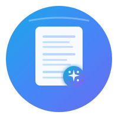

# ResumeAI — Intelligent CV Analysis Platform

**An end-to-end AI-powered resume analyzer with multi-agent architecture, explainable AI, privacy-first design, and dual-mode recruiter/candidate experience.**

[](https://fastapi.tiangolo.com)
[](https://nextjs.org)
[](https://python.org)
[](https://typescriptlang.org)
[](LICENSE)

</div>

---

## 📸 Screenshots

<table>
  <tr>
    <td align="center"><b>Landing Page</b></td>
    <td align="center"><b>Dark Mode</b></td>
  </tr>
  <tr>
    <td>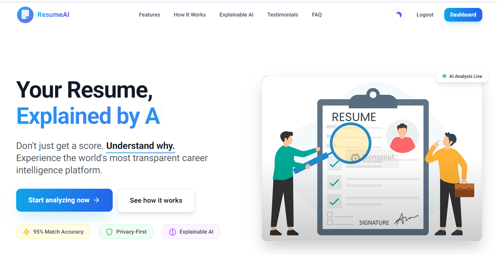</td>
    <td>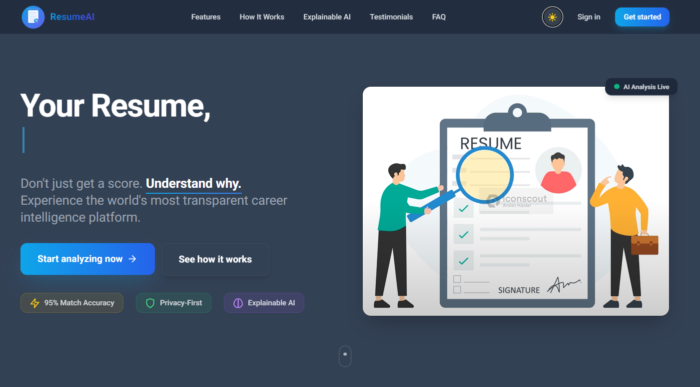</td>
  </tr>
  <tr>
    <td align="center"><b>Candidate Dashboard</b></td>
    <td align="center"><b>Recruiter Dashboard</b></td>
  </tr>
  <tr>
    <td>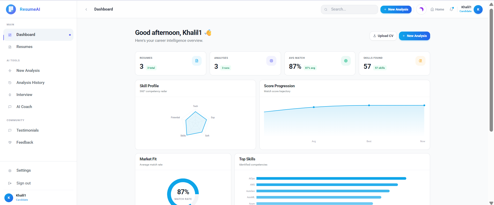</td>
    <td>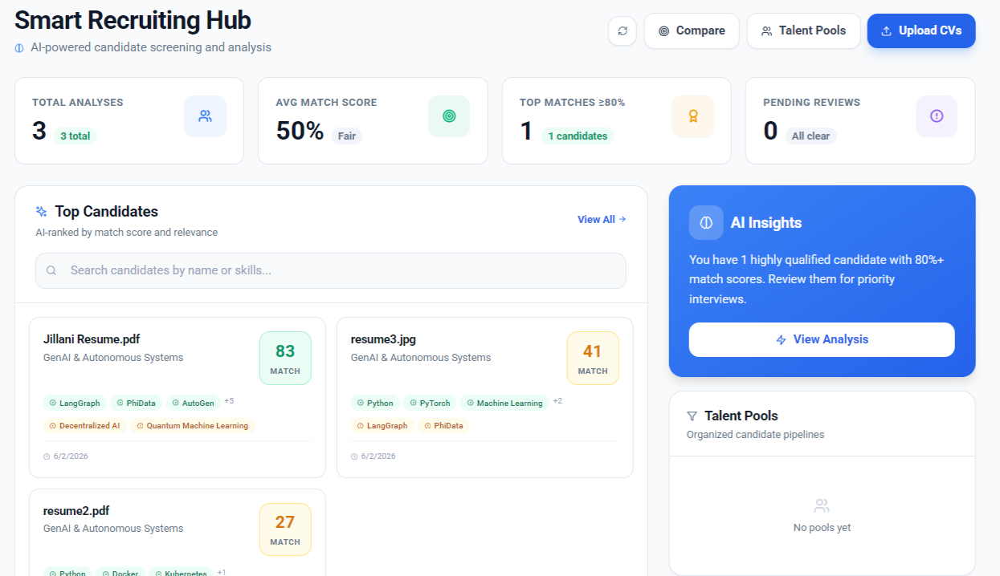</td>
  </tr>
  <tr>
    <td align="center"><b>Analysis Summary</b></td>
    <td align="center"><b>Skills & Expertise Match</b></td>
  </tr>
  <tr>
    <td>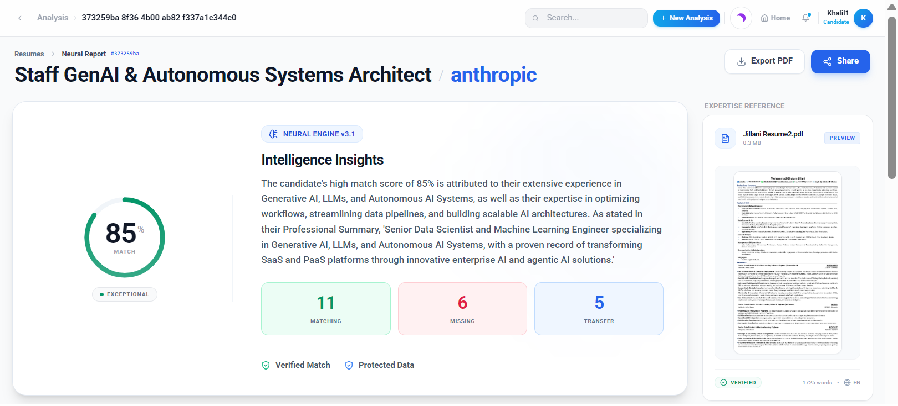</td>
    <td></td>
  </tr>
  <tr>
    <td align="center"><b>SHAP Force Plot & Cumulative Attribution</b></td>
    <td align="center"><b>Feature Importance Matrix</b></td>
  </tr>
  <tr>
    <td></td>
    <td></td>
  </tr>
  <tr>
    <td align="center"><b>Gap Analysis & Semantic Evidence</b></td>
    <td align="center"><b>Executive Interpretation & Trust Audit</b></td>
  </tr>
  <tr>
    <td></td>
    <td></td>
  </tr>
  <tr>
    <td align="center"><b>What-If Scenario Simulator</b></td>
    <td align="center"><b>Roadmap & Career Coaching</b></td>
  </tr>
  <tr>
    <td></td>
    <td>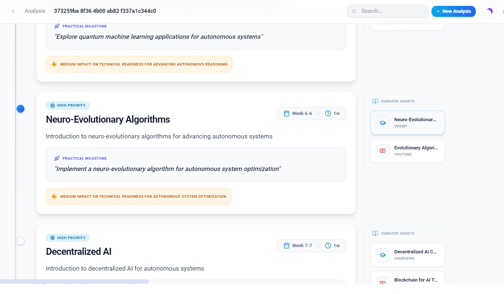</td>
  </tr>
  <tr>
    <td align="center"><b>AI Chat — Candidate</b></td>
    <td align="center"><b>AI Chat — Recruiter</b></td>
  </tr>
  <tr>
    <td></td>
    <td>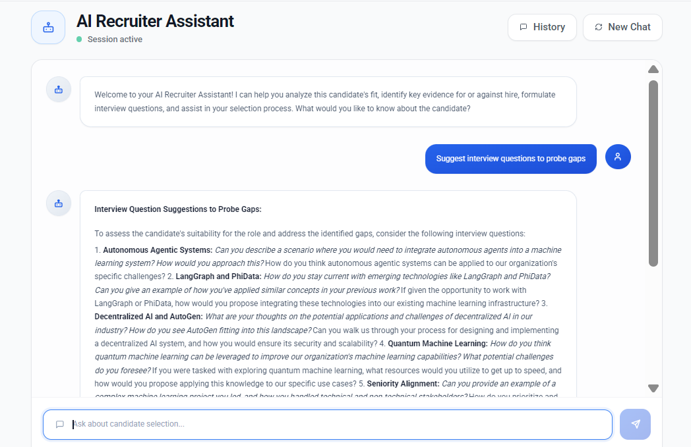</td>
  </tr>
  <tr>
    <td align="center"><b>Batch Ranking & Interview Questions</b></td>
    <td align="center"><b>Talent Pool</b></td>
  </tr>
  <tr>
    <td></td>
    <td>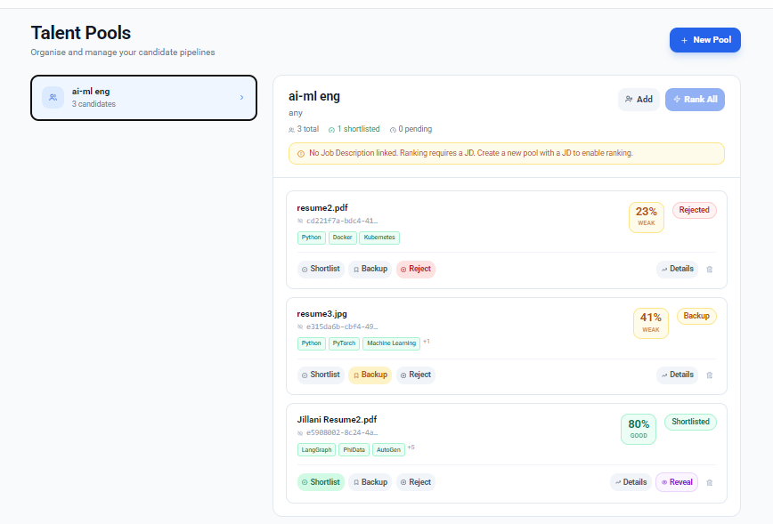</td>
  </tr>
  <tr>
    <td align="center"><b>Interview Training</b></td>
    <td align="center"><b>Interview History</b></td>
  </tr>
  <tr>
    <td></td>
    <td></td>
  </tr>
  <tr>
    <td align="center"><b>Document Upload — Candidate</b></td>
    <td align="center"><b>Document Status — Recruiter</b></td>
  </tr>
  <tr>
    <td></td>
    <td></td>
  </tr>
  <tr>
    <td align="center"><b>Sign In</b></td>
    <td align="center"><b>Register</b></td>
  </tr>
  <tr>
    <td>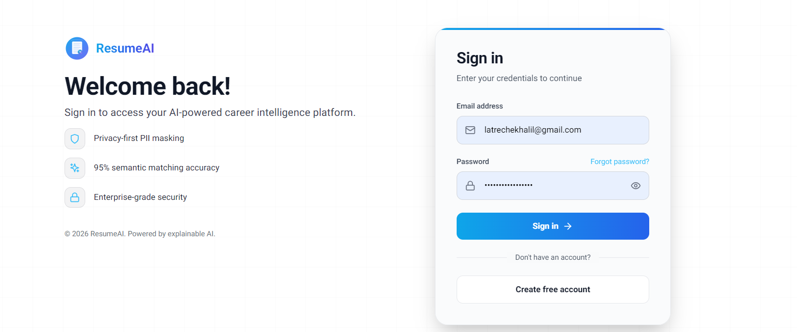</td>
    <td>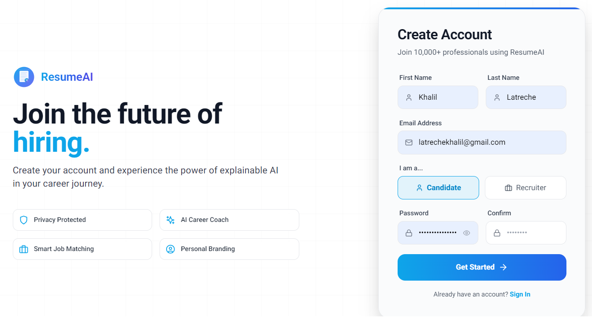</td>
  </tr>
  <tr>
    <td align="center"><b>Email Verification Code</b></td>
    <td align="center"><b>Password Reset</b></td>
  </tr>
  <tr>
    <td></td>
    <td></td>
  </tr>
  <tr>
    <td align="center"><b>Feedback</b></td>
    <td align="center"><b>Testimonials</b></td>
  </tr>
  <tr>
    <td></td>
    <td></td>
  </tr>
  <tr>
    <td align="center"><b>Settings</b></td>
    <td align="center"><b>Drag & Drop Upload</b></td>
  </tr>
  <tr>
    <td>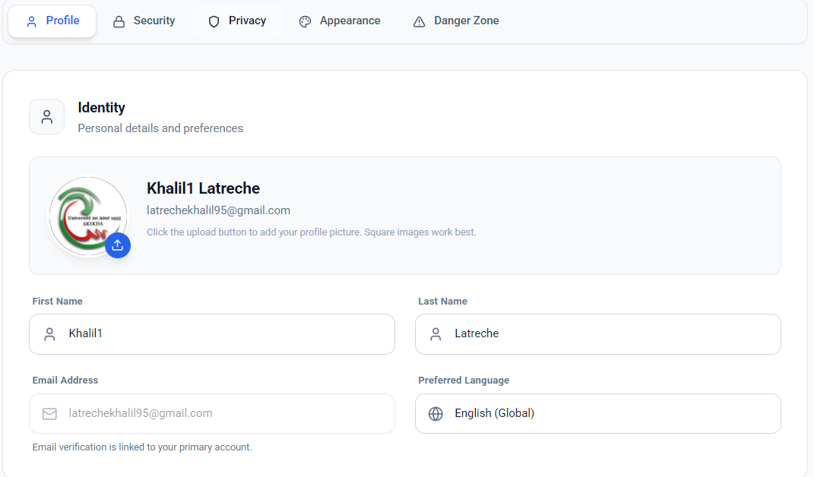</td>
    <td>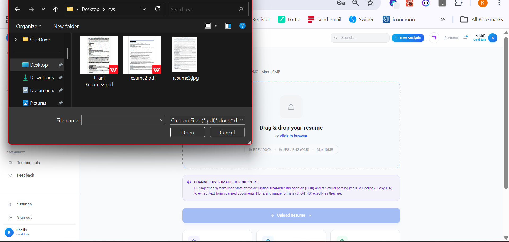</td>
  </tr>
</table>

---

## 🚀 Overview

ResumeAI is a full-stack intelligent platform that analyzes resumes against job descriptions using a **multi-agent AI pipeline**. It provides role-segregated experiences for candidates and recruiters, with a strong emphasis on privacy, explainability, and actionable feedback.

### Key Highlights

- 🤖 **4-Agent Pipeline** — Extraction → Matching → Gap Analysis → XAI
- 🔐 **Privacy-First** — AES-256-GCM PII encryption, Presidio-based masking, audit logging
- 📊 **Explainable AI** — SHAP-style force plots, waterfall charts, feature importance matrices
- 🎯 **Dual-Mode LLM** — Separate candidate coaching prompts vs. recruiter hiring decision prompts
- 🏆 **Batch Ranking** — Score and rank multiple candidates against a job description simultaneously
- 💬 **AI Chat** — Role-aware conversational assistant for both candidates and recruiters
- 🎤 **Interview Training** — AI-powered mock interview with real-time feedback
- 🗺️ **Career Roadmap** — Personalized skill development roadmap generation
- 🔭 **What-If Simulator** — Test how adding skills would affect the match score
- 🌍 **Multilingual** — Auto language detection, LLM output in detected language
- 🌙 **Dark / Light Mode** — Full theme support

---

## 🏗️ Architecture

```
┌─────────────────────────────────────────────────────────────┐
│                        Frontend (Next.js 14)                │
│  Candidate Dashboard  │  Recruiter Dashboard  │  Auth Pages │
└──────────────────────────────┬──────────────────────────────┘
                               │ REST API (HTTP/JSON)
┌──────────────────────────────▼──────────────────────────────┐
│                      Backend (FastAPI)                       │
│                                                             │
│  ┌──────────┐  ┌──────────┐  ┌──────────┐  ┌──────────┐   │
│  │Extraction│→ │ Matching │→ │   Gap    │→ │   XAI    │   │
│  │  Agent   │  │  Agent   │  │  Agent   │  │  Agent   │   │
│  └──────────┘  └──────────┘  └──────────┘  └──────────┘   │
│                                                             │
│  Privacy Gateway │ RAG Engine │ Batch Ranker │ Celery Tasks │
└──────────────────────────────┬──────────────────────────────┘
                               │
        ┌──────────────────────┼──────────────────────┐
        ▼                      ▼                      ▼
   SQLite / PG            ChromaDB               Redis
   (Main DB)           (Vector Store)        (Cache/Queue)
```

---

## 🧠 AI Pipeline

| Stage | Component | Technology |
|-------|-----------|------------|
| **1. Extraction** | PDF/DOCX/Image parsing + NER | Docling, EasyOCR, GLiNER |
| **2. Embedding** | Semantic vector generation | `all-MiniLM-L6-v2` (sentence-transformers) |
| **3. RAG Retrieval** | Adaptive context construction | ChromaDB, cosine similarity |
| **4. Matching** | Dual-mode LLM scoring | Groq (Llama 3 8B) + OpenRouter |
| **5. Gap Analysis** | Missing skills & recommendations | LLM + skill taxonomy |
| **6. XAI** | SHAP-style explanations | Custom attribution engine |
| **7. Language** | Auto language detection | langdetect |

**RAG Strategy:** If CV > 5000 chars → `masked_cv[:1000]` as overview + top-8 ChromaDB chunks. Otherwise → full text directly.

---

## 📁 Project Structure

```
final-ai-resume-analyzer/
├── backend/
│   ├── app/
│   │   ├── api/v1/endpoints/     # REST API routes
│   │   │   ├── analysis.py       # Core analysis endpoints
│   │   │   ├── auth.py           # JWT auth + password reset
│   │   │   ├── recruiter.py      # Recruiter-specific endpoints
│   │   │   ├── talent_pool.py    # Talent pool management
│   │   │   ├── coaching.py       # AI coaching & interview
│   │   │   └── documents.py      # CV upload & management
│   │   ├── core/
│   │   │   ├── config.py         # Environment configuration
│   │   │   ├── constants.py      # Skill stop-words, thresholds
│   │   │   └── circuit_breaker.py
│   │   ├── models/               # SQLAlchemy ORM models
│   │   ├── services/
│   │   │   ├── agents/
│   │   │   │   ├── extraction_agent.py
│   │   │   │   ├── matching_agent.py      # Dual-mode prompts
│   │   │   │   ├── gap_analysis_agent.py
│   │   │   │   ├── xai_agent.py           # SHAP-style XAI
│   │   │   │   └── multi_agent_orchestrator.py
│   │   │   ├── nlp/
│   │   │   │   └── groq_client.py
│   │   │   ├── privacy/          # PII masking + encryption
│   │   │   ├── recruiter/
│   │   │   │   └── batch_ranking.py
│   │   │   └── validation/
│   │   │       └── virus_scanner.py
│   │   └── main.py
│   ├── alembic/                  # DB migrations
│   ├── fix_stuck_cvs.py          # Maintenance utility
│   └── requirements.txt
├── frontend/
│   ├── src/
│   │   ├── app/                  # Next.js App Router pages
│   │   ├── components/
│   │   │   ├── candidate/        # Candidate-specific views
│   │   │   ├── recruiter/        # Recruiter-specific views
│   │   │   ├── shared/           # DashboardLayout, etc.
│   │   │   ├── auth/             # Login, Register forms
│   │   │   └── landing/          # Public landing page
│   │   ├── hooks/                # useAnalysisData, useAuth, etc.
│   │   └── store/                # Zustand global state
│   ├── public/
│   │   └── logo-new.svg
│   └── next.config.js
├── implementation/               # Screenshots
└── README.md
```

---

## ⚙️ Tech Stack

### Backend
| Library | Version | Purpose |
|---------|---------|---------|
| FastAPI | 0.109.0 | Async REST API framework |
| SQLAlchemy | 2.0.25 | ORM + async DB access |
| Alembic | 1.13.1 | Database migrations |
| Docling | ≥2.9.0 | PDF layout-aware extraction |
| EasyOCR | ≥1.7.0 | OCR for image-based CVs |
| GLiNER | ≥0.1.0 | Zero-shot Named Entity Recognition |
| sentence-transformers | 2.3.1 | `all-MiniLM-L6-v2` embeddings |
| ChromaDB | 0.4.22 | Vector store for RAG |
| Groq | 1.5.0 | Llama 3 8B (sub-2s inference) |
| OpenAI (OpenRouter) | 1.30.1 | Multi-model access |
| Presidio | 2.2.351 | PII detection & masking |
| cryptography | 42.0.2 | AES-256-GCM PII encryption |
| Celery | 5.3.6 | Background task queue |
| Redis | 5.0.1 | Cache + rate limiting |
| PyJWT | 2.8.0 | JWT tokens |
| bcrypt | 4.1.2 | Password hashing |
| slowapi | 0.1.9 | Rate limiting |
| WeasyPrint | 61.2 | PDF report export |

### Frontend
| Library | Version | Purpose |
|---------|---------|---------|
| Next.js | 14.1.0 | React framework (App Router) |
| TypeScript | 5.3.3 | Type safety |
| Tailwind CSS | 3.4.1 | Utility-first styling |
| Framer Motion | 11.0.3 | Animations |
| Recharts | 2.12.7 | Score visualizations |
| Zustand | 5.0.12 | Global state management |
| TanStack Query | 5.99.1 | Server state + caching |
| React Hook Form | 7.72.1 | Form management |
| Zod | 4.3.6 | Schema validation |
| Radix UI | 1.x–2.x | Accessible UI primitives |
| Lucide React | 0.263.1 | Icon system |
| next-themes | 0.4.6 | Dark/light mode |
| Sonner | 2.0.7 | Toast notifications |

---

## 🔧 Getting Started

### Prerequisites

- Python 3.11+
- Node.js 18+
- Redis (running on port 6379)
- ChromaDB (running on port 8001)

### 1. Clone the Repository

```bash
git clone https://github.com/Latreche-khalil14/Ai-Resume-analyse.git
cd Ai-Resume-analyse
```

### 2. Backend Setup

```bash
cd backend

# Create virtual environment
python -m venv venv
venv\Scripts\activate        # Windows
# source venv/bin/activate   # Linux/Mac

# Install dependencies
pip install -r requirements.txt

# Configure environment
copy .env.example .env
# Edit .env and fill in your keys (see Environment Variables section below)

# Run database migrations
alembic upgrade head

# Start the backend
uvicorn app.main:app --reload --host 0.0.0.0 --port 8000
```

### 3. Frontend Setup

```bash
cd frontend

# Install dependencies
npm install

# Start the development server
npm run dev
```

The application will be available at:
- **Frontend**: http://localhost:3000
- **Backend API**: http://localhost:8000
- **API Docs**: http://localhost:8000/docs

---

## 🔑 Environment Variables

Copy `backend/.env.example` to `backend/.env` and fill in the following:

| Variable | Required | Description |
|----------|----------|-------------|
| `DATABASE_URL` | ✅ | SQLite or PostgreSQL connection string |
| `SECRET_KEY` | ✅ | JWT signing secret (min 32 chars) |
| `REDIS_URL` | ✅ | Redis connection URL |
| `OPENROUTER_API_KEY` | ✅ | OpenRouter API key for LLM access |
| `GROQ_API_KEY` | ✅ | Groq API key for fast inference |
| `SMTP_HOST` | ⚠️ | SMTP server for email verification |
| `SMTP_USER` | ⚠️ | Email address for sending |
| `SMTP_PASSWORD` | ⚠️ | Email app password |
| `CLAMAV_HOST` | ⚠️ | ClamAV host (set `SKIP_VIRUS_SCAN=true` for dev) |
| `ENVIRONMENT` | ✅ | `development` or `production` |

> **Note:** In development, you can set `SKIP_VIRUS_SCAN=true` to bypass ClamAV. In production, ClamAV is required (fail-closed).

---

## 🛡️ Security Features

| Feature | Implementation |
|---------|---------------|
| **PII Masking** | Microsoft Presidio (regex + ML models) |
| **PII Encryption** | AES-256-GCM with per-field blind indexing |
| **Prompt Injection Defense** | Input sanitization in matching agent |
| **Virus Scanning** | ClamAV (fail-closed in production) |
| **JWT Auth** | HttpOnly cookies, secure flag in production |
| **Rate Limiting** | SlowAPI with Redis sliding window |
| **RBAC** | Role-based access (candidate / recruiter / admin) |
| **CSP Headers** | Full Content Security Policy in Next.js |
| **SQL Injection** | Parameterized queries throughout |
| **Circuit Breakers** | Automatic fallback for external services |

---

## 👥 User Roles

### 🎓 Candidate
- Upload CV (PDF, DOCX, or image)
- Run AI analysis against any job description
- View match score, skill gaps, SHAP explanations
- Chat with AI career coach
- Practice mock interviews with AI feedback
- Generate personalized career roadmap
- Use What-If scenario simulator
- View analysis history

### 🏢 Recruiter
- Upload multiple CVs at once
- Create and manage job descriptions
- Batch rank candidates with leaderboard
- View per-candidate analysis with interview questions
- Manage talent pool
- Chat with AI hiring assistant
- View analysis history (recruiter analyses only)

---

## 🗄️ Database Migrations

```bash
# Apply all migrations
alembic upgrade head

# Create a new migration
alembic revision --autogenerate -m "your_description"

# Rollback one step
alembic downgrade -1
```

---

## 🔧 Maintenance

### Fix Stuck CVs

If CVs get stuck in `processing` state (e.g., after a server restart):

```bash
cd backend
python fix_stuck_cvs.py
```

This resets any CVs stuck in `processing` to `failed` status so they can be re-uploaded.

---

## 📊 Scoring Model

The composite match score is calculated across 4 dimensions:

| Dimension | Weight | Description |
|-----------|--------|-------------|
| **Technical Skills** | 40% | Skill overlap between CV and JD |
| **Experience** | 30% | Years and relevance of experience |
| **Education** | 20% | Degree and field alignment |
| **Soft Skills** | 10% | Communication, leadership, teamwork |

The XAI module generates SHAP-style attributions showing exactly how each dimension contributed to the final score, including a force plot visualization and cumulative attribution chart.

---

## 🌍 Multilingual Support

The system automatically detects the language of each CV using `langdetect`. The detected language is passed as an output directive in every LLM prompt, so analysis results are returned in the same language as the CV. This does not alter chunking or extraction logic.

---

## 📄 License

This project is licensed under the MIT License — see the [LICENSE](LICENSE) file for details.

---

## 🎓 Academic Context

This project was developed as a Master's thesis at **[Your University Name]**, Department of Computer Science.

> **Title:** AI-Powered Resume Analysis System with Multi-Agent Architecture, Explainable AI, and Privacy-First Design

---

<div align="center">
  <sub>Built with ❤️ using FastAPI, Next.js, and Llama 3</sub>
</div>
